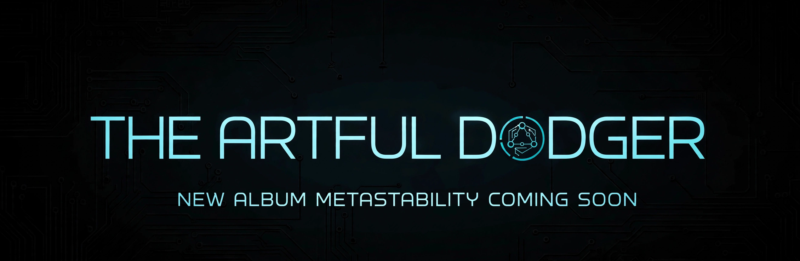

# The Artful Dodger

The Artful Dodger is dark drum & bass and techno from Bennington, Vermont. Started in 2009 with the debut album East Coast Lhack Wead. Seventeen years later the project's back in the lab — new machines, new methods, same late-night frequencies. New album Metastability coming soon.

- [Bandcamp](https://theartfuldodger1.bandcamp.com)
- [Website](https://kellner-dot.github.io/theartfuldodger-site/)

## Releases

- **Tuff Old Bird** — single, released November 18, 2026 — [Bandcamp](https://theartfuldodger1.bandcamp.com/album/tuff-old-bird) — free / name your price
- **Fugue State** — single, released November 18, 2026 — [Bandcamp](https://theartfuldodger1.bandcamp.com/album/fugue-state) — free / name your price
- **Rising Edge** — single, released November 18, 2026 — [Bandcamp](https://theartfuldodger1.bandcamp.com/album/rising-edge) — free / name your price
- **East Coast Lhack Wead** — debut album, 2009 — [Bandcamp](https://theartfuldodger1.bandcamp.com/album/east-coast-lhack-wead)

## Metastability

The new album — coming soon. Tracklist provisional; no release date set.

1. **Rising Edge** — 4:07 — single out now
2. **Latch** — 6:09 — in progress
3. **Fugue State Rework v2** — 3:54 — single out now as "Fugue State"
4. **Overclock** — 2:27
5. **Bit Shift** — 4:36 — mono fix done
6. **Kernel Panic** — 3:43 — rework queued; placement not confirmed
7. **Signal Drift** — 4:43
8. **Sample Hold** — 3:46
9. **Spinlock** — 3:48
10. **Handshake** — 4:02
11. **Wave Function** — 4:19

Plus a spoken intermission (0:26) between tracks 6 and 7, a closing line (0:13) after track 11, and two bonus tracks in the works — a sub-bass trap and a fast-paced dubstep, titles to come. Total runtime ≈ 46:15, ≈ 54 minutes with bonuses.

## Pops Improv — George E. Ackerman

- **Pops Improv** — 7:54
- **Two Generations** (feat. David Kellner) — 4:02

Releasing December 4, 2026 via RouteNote — approved.
